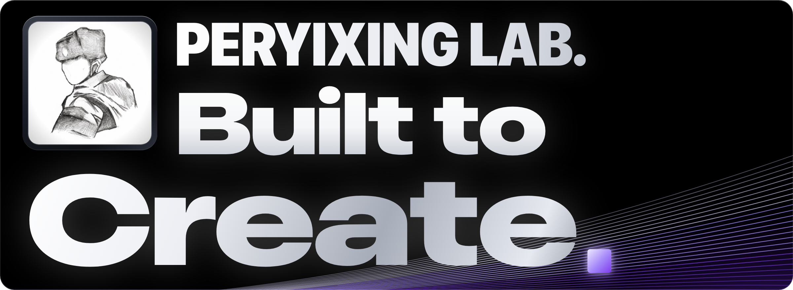
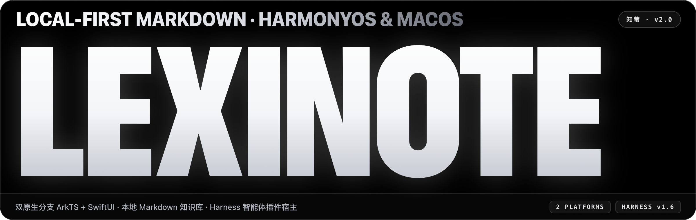
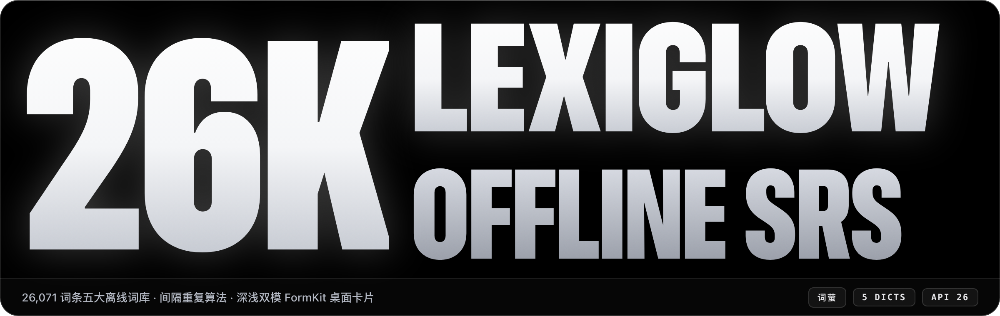
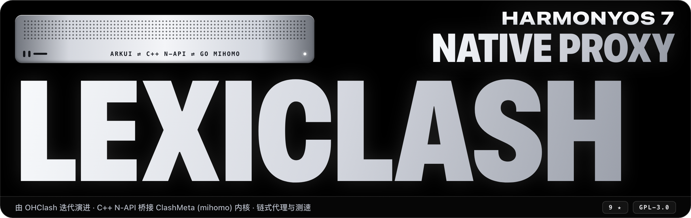
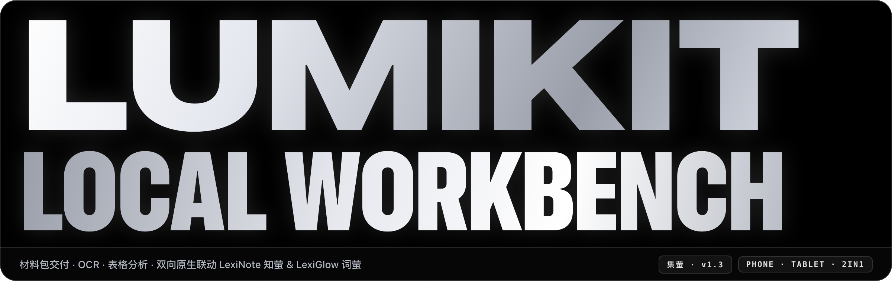
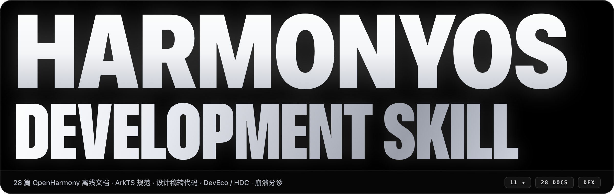
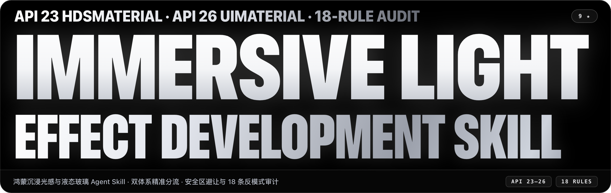
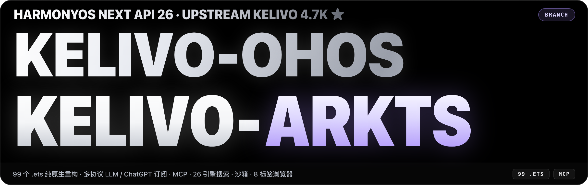

  

HarmonyOS NEXT 与 macOS 原生开发者，AI Agent 技能工程实践者。专注端侧原生架构、本地优先软件与鸿蒙沉浸交互体验。  
HarmonyOS NEXT & macOS native developer and AI-agent tooling builder. Crafting local-first apps, native architectures, and immersive experiences.

  
  
  
  

## 原生应用 / Native Applications

知萤 LexiNote：本地优先的 Markdown 笔记与知识整理应用，按平台分支独立维护 HarmonyOS（ArkTS / ArkUI）与 Apple Silicon macOS（SwiftUI / AppKit）工程，并内置 Harness 智能体插件宿主。  
Local-first Markdown note-taking and knowledge organization app maintaining dedicated native HarmonyOS (ArkTS) and Apple Silicon macOS (SwiftUI) branches with an experimental Harness agent plugin host.

  
  
  

词萤 LexiGlow：面向中国英语学习者的 HarmonyOS（API 26）原生单词记忆应用，以间隔重复算法为核心驱动，内置五大离线词书（26,071 词条）与深浅双模桌面卡片。  
Native HarmonyOS (API 26) English vocabulary memorization app powered by spaced repetition, featuring 5 built-in offline dictionaries (26,071 entries) and light/dark FormKit home-screen widgets.

  
  
  

LexiClash：由 OHClash 迭代演进的 HarmonyOS 7 原生代理客户端，使用 ArkTS / ArkUI 构建交互，通过 C++ / N-API 桥接 Go / mihomo 内核，支持订阅配置、延迟测速与链式代理。  
HarmonyOS 7+ native proxy client evolved from OHClash, pairing an ArkTS / ArkUI interface with a Go / mihomo core through a C++ N-API native bridge.

  
  
  

集萤 LumiKit：HarmonyOS 原生、本地优先的个人工具工作台，集材料包批量交付、OCR 识别、物品档案、表单与表格分析于一身，并与知萤、词萤实现原生生态联动。  
HarmonyOS native, local-first personal workbench uniting material-pack delivery, OCR, item registries, forms, and table analytics, natively linked with LexiNote and LexiGlow.

  
  
  

## 智能体技能 / Agent Skills

HarmonyOS-Development-Skill：一站式鸿蒙 NEXT 全链路开发 Agent 技能包，内置 28 篇 OpenHarmony 离线文档检索、ArkTS / ArkUI 规范、设计稿转代码、DevEco / HDC 工具链与崩溃日志分诊。  
All-in-one HarmonyOS NEXT Agent Skill integrating 28 offline OpenHarmony docs, ArkTS/ArkUI coding rules, design-to-code workflows, DevEco/HDC toolchains, and FaultLog crash triage.

  
  
  

Immersive-Light-Effect-Development-Skill：HarmonyOS 沉浸光感与液态玻璃开发技能包，精确分流 API 23 `hdsMaterial` 与 API 26 `uiMaterial` 双体系，涵盖安全区避让与 18 条反模式静态审计。  
HarmonyOS Immersive Light & Liquid Glass Agent Skill covering dual API 23 `hdsMaterial` / API 26 `uiMaterial` systems, SafeArea avoidance, and an 18-rule static audit script.

  
  
  

## 开源重构分支 / Open-Source Native Port

`kelivo-ohos`（`kelivo-ArkTS` 分支）：基于 HarmonyOS NEXT（API 26）Stage 模型与纯粹 ArkTS / ArkUI 原生重构的多模型 AI 对话与 Agent 自动化工作台，全面对齐上游 Kelivo 协议生态，支持 MCP、沙箱工作区、26 种搜索引擎与 8 标签 ArkWeb 浏览器。  
HarmonyOS NEXT (API 26) native ArkTS rewrite on the `kelivo-ArkTS` branch of `kelivo-ohos`, aligning with upstream Kelivo protocols alongside MCP, sandbox workspaces, 26 search adapters, and an 8-tab ArkWeb browser.

  
  
  

